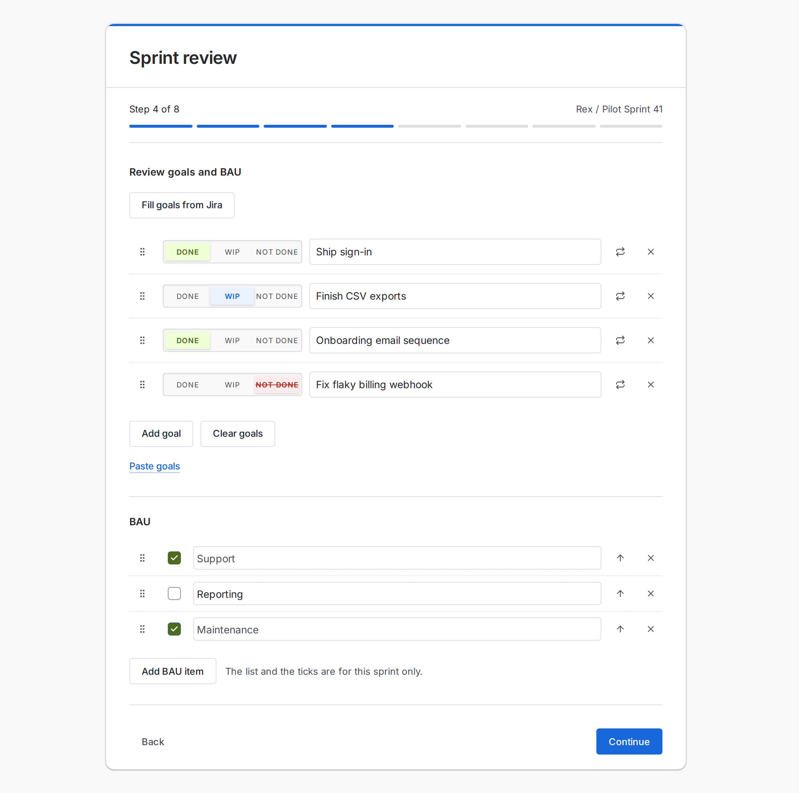
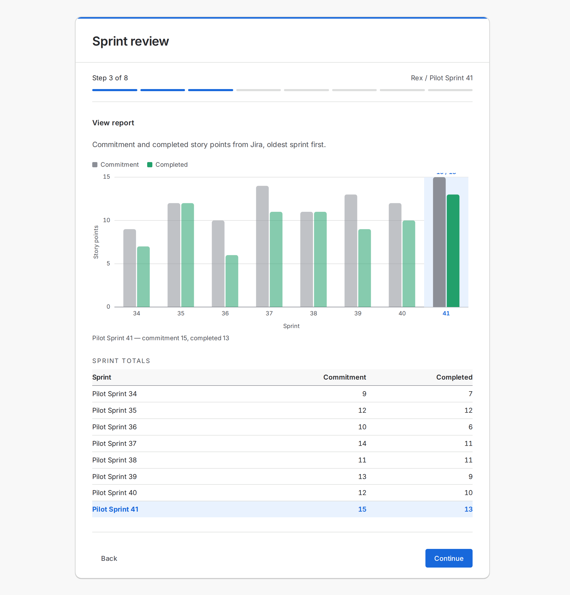
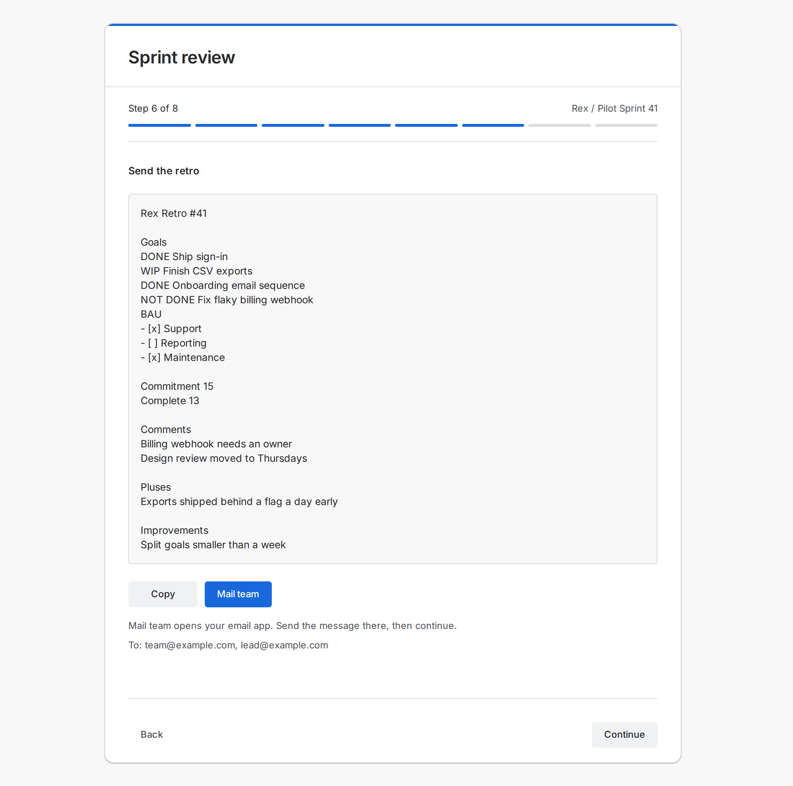

<p align="center">
  
</p>

<h1 align="center">Retrofast</h1>

<p align="center">
  Close a Jira sprint, write its retro and plan the next one in a single pass.
  <br>
  Astro on Cloudflare Workers, behind Cloudflare Access.
</p>

<p align="center">
  
</p>

## Why it exists

Our retro used to be a manual routine. Copy the sprint goals out of Jira into a note, type DONE or WIP next to each one, look up the committed and completed points, write comments, pluses and improvements, then paste the whole thing into an email. Then do it again in reverse to set up next sprint's goals.

Retrofast does the Jira reads and writes for you. You make the calls (what got done, what you noticed), and it produces the email and next sprint's goal text in the exact format the team already reads.

## How a review goes

The app walks you through eight steps, one screen at a time, with Back and Continue.

| Step | What happens |
| --- | --- |
| 1. Choose a sprint | Pick the Space and sprint. Manual entry works when Jira is down. |
| 2. Complete the sprint in Jira | You close it in Jira. Continue checks that Jira agrees before moving on. |
| 3. View report | Velocity chart and sprint totals, drawn from Jira's own report data. |
| 4. Review goals and BAU | Mark every goal Done, WIP or Not done, and tick the recurring BAU items. Drag to reorder. |
| 5. Numbers and notes | Points refresh from Jira. You write comments, pluses and improvements. |
| 6. Send the retro | Mail team opens your email app with the recipients filled in. Copy puts rich HTML and plain text on the clipboard. |
| 7. Plan the next sprint | Unfinished goals carry over. BAU starts as this sprint's list. |
| 8. Preview and push | Writes the plan into the next future sprint's goal in Jira, or creates that sprint if none exists. |

[docs/WORKFLOW.md](docs/WORKFLOW.md) has the full rules for each step.

<table>
  <tr>
    <td width="50%"></td>
    <td width="50%"></td>
  </tr>
  <tr>
    <td align="center"><sub>Step 3. The velocity report, rendered inline.</sub></td>
    <td align="center"><sub>Step 6. The retro, ready to mail or copy.</sub></td>
  </tr>
</table>

## What the retro looks like

The output matches the letter the team was already sending by hand. The format tests pin it byte for byte against fixtures in [src/lib/\_\_fixtures\_\_](src/lib/__fixtures__).

```text
Rex Retro #41

Goals
DONE Ship sign-in
WIP Finish CSV exports
NOT DONE Fix flaky billing webhook
BAU
- [x] Support
- [ ] Reporting

Commitment 15
Complete 13

Comments
Billing webhook needs an owner

Pluses
Exports shipped behind a flag a day early

Improvements
Split goals smaller than a week
```

Empty sections drop out entirely, blank line included.

## Running it locally

You need Node 22.12 or newer.

```sh
npm ci
npm run dev        # http://localhost:4321
```

The app boots without any Jira credentials and runs in manual mode, so you can try the whole flow by pasting goals and typing points. To connect Jira, create a `.dev.vars` file in the repo root:

```sh
JIRA_SITE=https://your-site.atlassian.net
JIRA_EMAIL=you@example.com
JIRA_API_TOKEN=...
JIRA_TOKEN_EXPIRY=2027-08-20
```

`JIRA_API_TOKEN` has to be a classic, unscoped Atlassian token. Scoped tokens can't reach the velocity endpoint. `JIRA_EMAIL` must be the account the token belongs to, or every call returns 401. `JIRA_TOKEN_EXPIRY` is optional and drives a banner that warns you before the token runs out.

## Adding a team

Teams live in [config/teams.json](config/teams.json). Each entry maps a local ID to a Jira board:

```json
{
  "id": "rex",
  "fallbackName": "Rex",
  "titleTemplate": "Rex Retro #{sprint}",
  "boardId": 66,
  "recipients": ["team@example.com"]
}
```

The Space name shown in the picker comes from Jira, and `fallbackName` covers the case where Jira can't be reached. `recipients` is the only source for the Mail team address list, and the app does not let anyone edit it in the browser.

## How it's built

- [Astro](https://astro.build) with the Cloudflare adapter, deployed as one Worker. The page prerenders. Only the routes under `src/pages/api` run on demand.
- React islands for the form, styled with Tailwind and Atlassian design tokens so it feels familiar next to Jira.
- Base UI for selects, popovers and dialogs, and dnd-kit for drag-to-reorder.
- No database. Drafts and plans sit in `localStorage`, team config is the checked-in JSON file, and Jira credentials are Worker secrets.
- The velocity chart is hand-drawn SVG. Two bars per sprint didn't justify a chart library.

The API routes proxy Jira and check every write against a fresh read of the board first:

| Route | Does |
| --- | --- |
| `GET /api/spaces` | Jira Space names for the configured boards |
| `GET /api/sprints?team=` | Active and recent sprints, with goal text |
| `GET /api/velocity?team=&sprintId=` | Commitment and completed points for one sprint |
| `GET /api/velocity-report?team=` | The velocity series for the chart |
| `POST /api/push-plan` | Writes next sprint's goals, or creates the sprint. Returns 409 if Jira changed since you looked. |

None of the routes check auth themselves. Cloudflare Access sits in front of the whole hostname, so only signed-in teammates reach the Worker. Don't deploy it without Access, since it holds a Jira token.

## Tests

```sh
npm test                  # unit and route tests (Vitest)
npx tsc --noEmit          # types
npm run build             # production build
npm run test:initial-html # checks the loading fallback in the built HTML
```

The browser checks in `scripts/` drive the real UI with Playwright against fake Jira responses. Start `npm run dev` first, then run `npm run test:plan-mode`, `npm run test:bau-list` or `npm run test:layout-shift`.

## Deploying

```sh
npm run build && npx wrangler deploy
```

Set the four `JIRA_*` values with `wrangler secret put`. [docs/DEPLOY.md](docs/DEPLOY.md) covers the Access setup and token rotation.

## Further reading

- [docs/WORKFLOW.md](docs/WORKFLOW.md): the eight steps and the push-plan safety checks
- [docs/PLAN.md](docs/PLAN.md): design decisions, output format rules and the reasoning behind the UI
- [docs/research/](docs/research): Jira API feasibility notes and the Atlassian design system study
